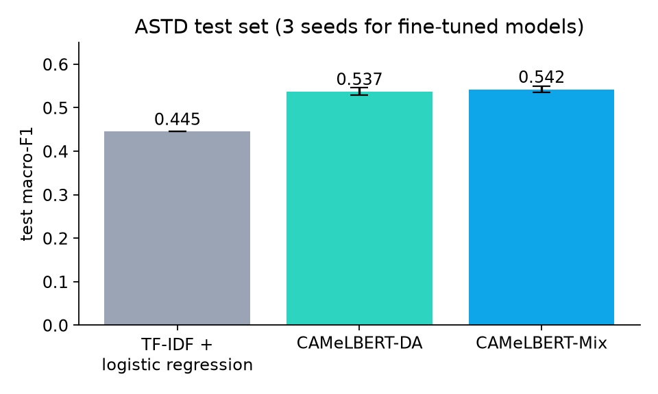
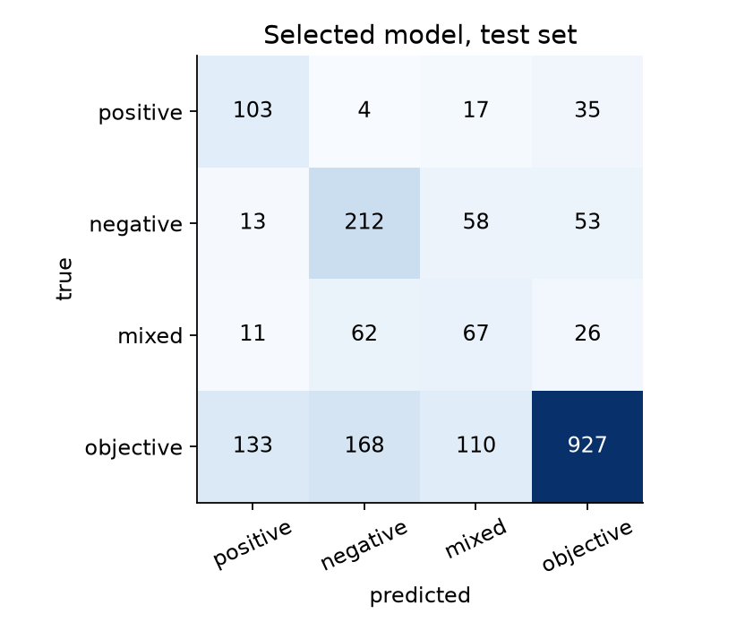

# Egyptian Arabic Sentiment Analysis

Classifies Egyptian-dialect Arabic text as **positive**, **negative**, **mixed** or **objective**. Compares a classic TF-IDF baseline with fine-tuned Arabic BERT models (CAMeLBERT) on ASTD, a dataset of about 10k Egyptian tweets, and shows where the models still fail.



## Results

Official ASTD 4-class split, test set of 1,999 tweets. Fine-tuned models ran with 3 seeds; scores show mean ± standard deviation.

| Model | Test macro-F1 | Test accuracy |
|---|---|---|
| TF-IDF + logistic regression | 0.445 | 0.618 |
| CAMeLBERT-DA (dialectal Arabic) | 0.537 ± 0.009 | 0.657 ± 0.007 |
| CAMeLBERT-Mix (MSA + dialects + classical) | **0.542 ± 0.008** | 0.656 ± 0.001 |

F1 per class, comparing the baseline with the selected CAMeLBERT-Mix run:

| | positive | negative | mixed | objective |
|---|---|---|---|---|
| Baseline | 0.369 | 0.427 | 0.219 | 0.767 |
| CAMeLBERT-Mix | 0.492 | 0.542 | 0.321 | 0.779 |

All numbers, per-seed runs and training curves are in [`results/metrics.json`](results/metrics.json).

### What the results say

- **Fine-tuning helps a lot.** Macro-F1 rises by about 0.10 over the baseline, and every class improves. The biggest gains are on the opinion classes.
- **The two CAMeLBERT variants are tied.** The gap between them (0.005) is smaller than the spread between seeds, so this run doesn't show that one is better.
- **"Mixed" is the hard class (F1 about 0.33).** It is the smallest opinion class, and 62 of the 166 mixed test tweets were predicted as negative. A sentence like "الأكل حلو بس الأسعار غالية اوي" ("the food is good but the prices are very high") came out positive.
- **Class weights have a cost.** Weighting rare classes lifts their recall, but 411 of the 1,338 objective tweets were predicted as some opinion.
- **Some errors are label noise.** Several "positive" tweets in the data are prayers or news headlines, and one training tweet labelled positive reads "the worst thing about today is your absence :-(".
- **Picking a run on validation is noisy.** The selected run had the best validation score (0.552) but the lowest test score among its seeds (0.533). That's why the table reports mean ± std over seeds and not a single best run.



## Approach

- **Data:** [ASTD](https://github.com/mahmoudnabil/ASTD), with its official 4-class unbalanced train / validation / test split (6,008 / 1,999 / 1,999 tweets). Two thirds of the tweets are objective, so models are compared on **macro-F1**, where every class counts equally.
- **Cleaning:** links and user handles become placeholder words, hashtag words are kept, diacritics and letter variants are normalized, and stretched letters are shortened ("حلوووو" becomes "حلوو"). Emojis and negation words are kept because they carry sentiment.
- **Baseline:** TF-IDF on word 1-2 grams and character 2-5 grams, with class-weighted logistic regression. `C` is tuned on validation.
- **Fine-tuning:** a plain PyTorch loop with class-weighted cross-entropy, AdamW, linear warm-up and decay, gradient clipping and mixed precision. Settings: 4 epochs, learning rate 2e-5, batch size 32, max 128 tokens.
- **No test-set tuning:** each run keeps the epoch with the best validation macro-F1, and the final model is also chosen on validation. The test split is only used to report results.

## Try it

`app.py` is a Gradio demo: type a sentence and see the score for each class. It loads the fine-tuned model from the Hugging Face Hub (`MODEL_ID`).

```bash
pip install -r requirements-app.txt
python app.py
```

## Reproduce

Training needs a GPU. Open `notebooks/train_colab.ipynb` in Google Colab, choose a T4 GPU and run all cells. The 7 models take about 15 minutes. `scripts/plot_results.py` redraws the charts from `results/metrics.json`.

Tests (no GPU needed; they use a tiny random model):

```bash
pip install pytest torch transformers scikit-learn gradio
pytest
```

## Project layout

```
src/egysent/
  data.py         download ASTD and load the official splits
  preprocess.py   tweet cleaning shared by all models
  train.py        TF-IDF baseline and the PyTorch fine-tuning loop
  metrics.py      accuracy, macro-F1, per-class F1, confusion matrix
notebooks/
  train_colab.ipynb   full training and evaluation run
results/          metrics.json and charts
app.py            Gradio demo
tests/            unit tests, a tiny-model training smoke test, an app test
```

## Limitations

- **The tweets are mostly political and from around 2013.** Product reviews or customer messages will look different, so expect lower accuracy there without more data.
- **Sarcasm and mixed opinions remain hard.** The model has no signal for sarcasm beyond the words themselves.
- **Hard cases are partly labelled inconsistently in ASTD,** which caps the score any model can reach.

## Licenses

The code is MIT. ASTD is GPL-2.0, so it is downloaded at run time and not redistributed here. The CAMeLBERT base models are Apache-2.0.
